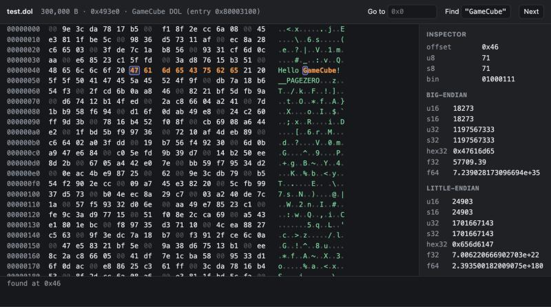

# binharness

A binary-analysis toolkit focused on Nintendo Switch NSO/NRO modules, with raw-byte inspection for other files, packaged three ways:

- **Codex plugin** (`hex-viewer`): an interactive hex viewer for compatible Codex clients, plus 24 analysis tools.
- **MCP server**: 25 tools in total: `view_binary` and the 24 analysis tools. The interactive viewer needs a client that supports MCP Apps; other clients can use the text tools.
- **`deepseek-bin`**: a standalone CLI agent that uses the same tools with DeepSeek models.



## What it can do

| Tool | What it does |
| --- | --- |
| `view_binary` | Interactive hex + ASCII viewer (Codex UI): go to offset, hex/text search, byte inspector |
| `file_info` | Identify format signatures; summarize NSO/NRO segments and symbols, NPDM declarations, or NSP/XCI container entries |
| `disassemble` | AArch64 disassembly with branch/data-reference annotations; x86-64 instruction disassembly is also available with `arch: "x86-64"` |
| `list_functions` | Estimate function boundaries from AArch64 call targets, relocations, init arrays and prologues |
| `call_graph` | Display detected direct AArch64 calls as a depth-limited tree; inferred boundaries and indirect calls can leave gaps |
| `scan_syscalls` | Find `svc #n` encodings in the text segment and label known Horizon syscall numbers; presence does not establish execution |
| `label_syscalls` | Label detected small functions with a single known syscall as candidate wrappers, and annotate SVC sites |
| `find_services` | Find known-looking Switch IPC service strings and detected references to them; references do not prove service use or ownership |
| `label_services` | Add `use_<service>` labels to eligible unnamed functions referencing one detected service, and annotate the strings |
| `label_from_strings` | Infer labels from diagnostic strings, such as the synthetic `"FixtureWorker::Run is called"`, when exactly one detected unnamed function references the string |
| `parse_npdm` | Read the program id, service declarations and syscall allowlist from NPDM ACI0; does not verify ACID signatures or actual runtime activity |
| `find_rtti` | Find candidate Itanium C++ RTTI names, vtables and method-slot counts from available metadata and relocations |
| `label_rtti` | Save inferred vtable labels and `<Class>::vf<n>` labels for detected method targets; these are not recovered original method names |
| `export_symbols` | Export collected function labels, vtable labels and comments as **Ghidra**/**IDA** import scripts or JSON |
| `find_xrefs` | Detect supported AArch64 calls, branches and data references to an address |
| `find_string_refs` | Find matching strings and supported AArch64 references to them |
| `list_symbols` | Demangled dynsym symbols and your saved labels |
| `search_bytes` | Hex patterns with `??` wildcards, or `"text"` |
| `decode_struct` | Decode memory with a C-like layout: `u32 magic; f32 pos[3]; char name[16]; ptr next` |
| `read_binary_chunk` | Hexdump by file offset or virtual address |
| `binary_strings` | `strings -t x` on a segment, with regex filter |
| `compare_files` | Byte-level diff of two files |
| `annotate` / `get_annotations` | Labels, comments and notes, saved per build id in `~/.binharness/` and shown in later disassembly |
| `extract_image` | Write the decompressed NSO/NRO image + JSON symbol map for Ghidra/IDA |

### Hand-off to Ghidra/IDA

`extract_image` and `export_symbols` are tool names, not shell executables. Ask your MCP client to call them with these arguments, replacing the paths:

```json
{"name":"extract_image","arguments":{"path":"/path/to/main","out":"/path/to/out.bin"}}
```

```json
{"name":"export_symbols","arguments":{"path":"/path/to/main","out":"/path/to/out","format":"both"}}
```

Load `out.bin` as a flat AArch64 binary at the base recorded in `out.bin.json` (default `0x7100000000`), then run the generated `out.ghidra.py` or `out.ida.py`. Review labels and import warnings in the destination tool. Function boundaries and labels are analysis hypotheses; indirect calls, missing relocations, optimized code and absent RTTI can reduce coverage.

### Format support and limits

| Level | Formats and behavior |
| --- | --- |
| Structured executable analysis | NSO with LZ4 segments; NRO; available segment/symbol metadata and Switch AArch64 analysis heuristics |
| Structured container/metadata reads | NSP/PFS0, XCI/HFS0 directory entries; NPDM ACI0 program/service/kernel declarations |
| Identification plus raw-byte tools | ELF, Mach-O, PE, image/archive formats, SQLite, wasm, Nintendo asset signatures, and GameCube/Wii file/image signatures; detection does not imply a format-specific loader, extractor or decoder |

Non-NSO/NRO inputs are treated as flat byte images for disassembly. ELF/Mach-O/PE sections and their load addresses are not mapped automatically. AArch64 reference/function analysis does not extend to x86-64 merely by selecting that disassembler. NSO/NRO addresses default to `0x7100000000`; override with `base` when needed.

NPDM results describe ACI0 declarations. The parser does not verify the ACID signature or establish effective authorization after loader/platform checks. An allowed service or syscall need not be used, and a referenced service string does not identify its provider.

Encrypted NCA files can be identified and inspected as raw bytes, but this toolkit does not decrypt them, acquire console keys or extract files from encrypted NCAs. Supply an NSO/NRO you are authorized to analyze. See [provenance and distribution boundaries](PROVENANCE.md).

## Requirements and MCP setup

The code targets Node.js 18+ and has no npm dependencies. Disassembly requires an LLVM-compatible executable named `objdump` on the process `PATH`, supporting `--triple`, `--no-show-raw-insn` and `--print-imm-hex`. GNU `objdump` is not a drop-in replacement for these arguments. If your installation names the LLVM binary `llvm-objdump`, expose it as `objdump` with an executable wrapper or symlink; a shell alias does not affect Node's `spawnSync`. Symbol and RTTI demangling also need `c++filt` with `-n` and `-t` support. Raw hex inspection does not need these executables.

For a checkout, configure your MCP client's stdio server command as:

```text
command: node
args: ["/absolute/path/to/binharness/plugins/hex-viewer/server.mjs"]
```

`package.json` defines `binharness-mcp` and `deepseek-bin` executables for a packaged install. This is not a claim that the package is currently published on npm; the checkout/local-node command above is the documented setup. `server.json` is draft registry publication metadata, without a verified registry launch recipe. The repository also contains a Codex marketplace manifest at `.agents/plugins/marketplace.json` and the `hex-viewer` plugin under `plugins/hex-viewer`; use the installation flow supported by your Codex version. Client configuration keys and installation commands vary by client/version.

Once connected, try *"Show my synthetic fixture in the hex viewer"* or *"Find references to the fixture's greeting string"*.

## deepseek-bin (DeepSeek CLI agent)

```bash
git clone https://github.com/dougchansan/binharness
cd binharness
node tests/make-fixture.mjs
export DEEPSEEK_API_KEY=your-api-key
node harness/deepseek-bin.mjs tests/fixture.nso
```

This starts an interactive session with streaming output and a tool-call trace. It sends prompts and selected tool results to the configured model API; the default endpoint is `https://api.deepseek.com`. One-shot mode using the synthetic fixture:

```bash
node harness/deepseek-bin.mjs -p "Explain the fixture's greeting-string references and cite the addresses" tests/fixture.nso
```

**Recon.** Run local metadata and naming passes before the model's analysis:

```bash
node harness/deepseek-bin.mjs --recon -p "What does this synthetic module do?" tests/fixture.nso
```

Recon runs `file_info`, `label_rtti`, `label_syscalls`, `label_services`, `label_from_strings` and a named `list_functions` summary. It also runs `parse_npdm` when the input filename is `main` and a sibling `main.npdm` exists. These passes make no model request themselves; their summaries enter the next API request and contribute to its input tokens. Saved labels persist, and their coverage depends on the input.

The current `--recon` file filter selects NSO and ELF signatures, not NRO. Use `/recon <file>` in the REPL for an NRO. ELF is treated as raw bytes rather than a mapped ELF image, so the advanced passes may fail or produce misleading results on it; NSO/NRO are the intended targets for these passes.

| Option | |
| --- | --- |
| `-m <model>` / `--pro` | Configured model; this code defaults to `deepseek-flash`, and `--pro` selects `deepseek-v4-pro`. Availability depends on the endpoint |
| `-e none\|low\|high\|max` | Thinking effort (`none` disables thinking) |
| `--show-thinking` | Stream the model's reasoning |
| `--max-steps N` | Tool rounds per task (default 60) |
| `--base-url <url>` | Model API base URL; also configurable with `DEEPSEEK_BASE_URL` |
| `-y` | Allow `extract_image` to write files without asking |

REPL commands: `/help`, `/recon <file>`, `/model`, `/effort`, `/add <file>`, `/files`, `/cost`, `/save notes.md`, `/reset`, `/exit`. Ctrl-C interrupts the current turn. The CLI's confirmation currently covers `extract_image` only; annotation/label tools, `export_symbols` and `/save` can write without that prompt.

**Usage and estimates.** Tool results sent to the model are capped at 16,000 characters per call, and the prompt asks for targeted reads. The conversation history is resent with each request. Cache use and billing depend on the provider; neither cache coverage nor savings is guaranteed. `/cost` uses provider-reported token counts and the hardcoded `PRICES` table in `harness/deepseek-bin.mjs`; its dollar amount is an estimate, not a current price quote or spending limit. Unknown models fall back to the built-in default model's rates.

### Data flow and generated outputs

The standalone agent includes requested disassembly, strings, byte excerpts, paths and annotations in model requests as they enter the conversation. Using a local binary does not keep those extracts local. A custom API endpoint receives the same request content; choose a provider and inputs appropriate for the rights and confidentiality requirements of your work. The MCP server itself runs local tools, while the connected client's data-handling policy determines where its tool results go.

Annotations are stored under `~/.binharness/`. Session JSONL logs contain prompts, model replies and tool-call metadata; `/save` also exports the conversation's tool results. `extract_image` writes the input's decompressed bytes. Model-generated C/C++, annotations and export scripts can contain information derived from the input; generating them does not establish independent provenance or redistribution rights. Review outputs before publishing. See [PROVENANCE.md](PROVENANCE.md) and the [distribution audit](docs/distribution-audit.md).

## Layout

```
.agents/plugins/marketplace.json     Codex marketplace "dougchansan"
plugins/hex-viewer/
  .codex-plugin/plugin.json          plugin manifest
  .mcp.json, server.mjs              stdio MCP server + view_binary UI wiring
  lib/bintools.mjs                   format handling, LZ4, tool dispatch, objdump wrapper
  lib/core.mjs, lib/re.mjs           reference decoding and analysis heuristics
  assets/app.html                    hex viewer UI (MCP App)
  skills/hex-viewer/SKILL.md         tells Codex when/how to use the tools
harness/deepseek-bin.mjs             DeepSeek agent
harness/fw-index.mjs                local module-directory index and declaration reports
tests/                               synthetic NSO fixture, mock DeepSeek API, test suite
```

## Validation and distribution audit

Run the synthetic test suite and distribution checks from a checkout:

```bash
npm test
npm run audit:dist
npm run audit:history
```

The audit commands check the surfaces documented in [docs/distribution-audit.md](docs/distribution-audit.md). They help detect packaging mistakes; they do not prove ownership, establish input provenance or grant permission to redistribute an artifact.

## License

MIT for the repository's own code. Input binaries and generated artifacts remain subject to their applicable rights; see [PROVENANCE.md](PROVENANCE.md).
